# Issue駆動AIエージェント：ラベル・状態遷移・実行排他の仕様

> 対応: #65 ／ 親Issue: #62  
> 状態: **仕様のみ**。この文書はエージェントの自動起動を有効化しない。実装と有効化は #67 以降で行う。

## 1. 適用範囲と安全上の不変条件

- 初期運用は、許可された人間がIssueに `agent:ready` を**新しく付けた**ときだけ着手候補とする。Issue作成・編集・コメント・PRコメントだけでは起動しない。Milestoneからの自動選択は #72。
- 初期値は **無効**。別途設定するキルスイッチ `AGENT_AUTORUN_ENABLED` が厳密に `true` の場合に限り、認可・排他検査の後に起動できる。この変数が未定義、読み取り不能、その他の値なら起動しない。設定の検証・有効化は #67 の別手順。
- 一つのIssueに同時に存在できるアクティブなエージェント実行は**最大1件**。リポジトリ全体の最大3件の実行枠は #69 が実装する。両条件を満たさなければ着手しない。
- エージェントは `main` に直接push・マージしない。PRの最終マージと本番運用の有効化は人間が行う。
- CI失敗とレビュー指摘に対する**自動修正は合計最大3回**。同じ失敗を際限なく再実行しない。修正回数はWorkflow再実行回数とは別に永続記録する（#68）。
- 取引認証情報、発注権限、注文実行機能（本番・模擬とも）はエージェントへ渡さない。通常テストは外部APIなしで実行する（#70）。
- ラベル・Issueコメントは**ユーザーインターフェース／監査表示**であり、単独では排他ロックや権限の根拠にしない。検証が不確かな場合は安全側に停止する。

## 2. ラベル定義（各Issueで同時に一つまで）

| ラベル | 用途 | 誰が遷移を要求するか | 推奨色 |
| --- | --- | --- | --- |
| `agent:ready` | 人間が着手・再着手を要求。まだ起動確定ではない | 許可された人間のみ | `#0E8A16` |
| `agent:running` | 有効な実行ロックを取得してエージェントが実行中 | 制御ジョブ | `#1D76DB` |
| `agent:review` | PRがありCI・レビュー・修正判断を待つ | 制御ジョブ | `#FBCA04` |
| `agent:needs-input` | 失敗・中断・権限/仕様不足で人の対処が必要 | 制御ジョブ／許可された人間 | `#D93F0B` |
| `agent:ready-to-merge` | 必要な検証が揃い、**人間のマージ判断のみ**残る | 制御ジョブ | `#5319E7` |

- ラベルがない状態は `idle` と呼ぶ。PRマージによる完了と手動キャンセルは、ラベルなしに戻し、完了／キャンセルの**理由と実行履歴**で識別する。単純なラベル削除は実行の停止命令ではない。
- 上記ラベルの複数併存、不明な状態、Issueが閉じているのに実行要求がある場合は**起動を拒否**し、記録して手動修復する。競合時に「適当に一つ選ぶ」実装は禁止。
- ラベル付け権限を持つ利用者が状態ラベルを直接変更しても、それだけで実行権限・実行完了・PRマージ可能性は与えない。変更にはサーバー側の検証が必要。
- ラベル名と色は仕様値。GitHubリポジトリへのラベル登録は管理者が行い、同名ラベルの用途が異なる場合は上書きせず確認する。

管理者向け初期作成コマンド（**実行前に既存ラベルと衝突しないことを確認**。`--force` は使わない）：

```bash
gh label create 'agent:ready' --color '0E8A16' --description 'Human-authorized request to start an agent run' --repo yu1Ro5/quant-lab
gh label create 'agent:running' --color '1D76DB' --description 'Agent execution active under an exclusive claim' --repo yu1Ro5/quant-lab
gh label create 'agent:review' --color 'FBCA04' --description 'PR pending CI, review or repair decision' --repo yu1Ro5/quant-lab
gh label create 'agent:needs-input' --color 'D93F0B' --description 'Agent halted; human intervention is required' --repo yu1Ro5/quant-lab
gh label create 'agent:ready-to-merge' --color '5319E7' --description 'Checks complete; human merge decision required' --repo yu1Ro5/quant-lab
```

作成後は `gh label list --repo yu1Ro5/quant-lab` で確認する。初期状態ではラベルだけが存在し、自動起動するWorkflowを有効にしない。

## 3. 状態遷移

```mermaid
stateDiagram-v2
    [*] --> Idle
    Idle --> Ready: 認可された人間が ready を付与
    Ready --> Running: 有効化済・認可・排他claim成功
    Ready --> NeedsInput: 認可失敗 / 実行準備失敗
    Running --> Review: Draft PR作成 / 初回検証完了
    Running --> NeedsInput: 中断 / タイムアウト / 実行失敗
    Review --> Running: CI・レビュー修正（通算3回以内）
    Review --> ReadyToMerge: 必須CI成功・確認完了
    Review --> NeedsInput: 修正上限 / ブロッカー
    ReadyToMerge --> Review: CI無効化 / 新しい指摘
    ReadyToMerge --> NeedsInput: 人間が保留
    NeedsInput --> Ready: 人間が原因対応し再着手を明示
    ReadyToMerge --> Idle: 人間がPRをマージし完了記録
    NeedsInput --> Idle: 人間がキャンセルを確定
    Ready --> Idle: 人間が着手を撤回
```



**遷移の前提：**
1. `Ready -> Running` は、(a)起動フラグ有効、(b)Issueオープン、(c)イベントが `issues.labeled` の `agent:ready`、(d)イベント送信者が許可リスト内かつリポジトリの `write` 以上の権限、(e)状態・既存PR・依存条件の再確認、(f)Issue単位の排他claim成功、の全てを必要とする。初期段階では他のトリガーを許可しない。
2. `Running -> Review` はPR番号・ブランチ・開始コミット・run IDを記録してから行う。PRが未作成なら `needs-input` にし、原因を残す。
3. `Review -> Running` は同一Issue・既存PRに対する修正再開であり、新しいPRを作らない。**新しいworker実行ごとに別のrun IDで排他claimを再取得**するが、`repair_count` はIssue・PR単位で通算する。修正上限と停止フラグを再確認する。
4. `Review -> ReadyToMerge` はCI、レビュー、必要な実機確認などの**実際の**完了を確認してから行う。ラベルだけでマージできることにはしない。
5. `needs-input -> ready` は、人間が原因と残タスクを確認し、実行停止・ロック解放を確認した後の**明示的な再付与**である。自動再付与しない。
6. どの状態からでも人間による停止要求を受け付ける。稼働中は停止完了・ロック清算を確認するまで次の実行を許可しない。
7. 許可されない遷移は無視して監査記録し、状態の競合や不整合なら `needs-input` への手動修正を要求する。自動的に循環しない。

## 4. 複数イベント・再送に対する排他と冪等性

**claimは一つのworker実行中だけ保持する。** `running -> review` でworkerを終了し、監査更新後にロックを解放する。レビュー待ちの間はロックを保持し続けない。レビュー指摘による次の修正は同じPRを対象として改めてclaimを取得し、複数workerが同じIssue/PRを同時編集しないことを保証する。GitHub全体のレビュー待ち状態はラベルとrun記録で追跡する。

**GitHub Actionsの `concurrency` だけをロックとしない。** 実行待ちキューの扱いや再実行を含む永続的な一意性を保証するため、別の排他claimを設ける。GitHub Actionsは補助的な同一Issue直列化（例: `group: agent-issue-${{ github.event.issue.number }}`、`cancel-in-progress: false`）に用いる。最大3並列の実行枠管理は別途 #69。

推奨するGitHub上のclaim方式（#67で実APIの競合テストを必須とする）：

1. 認可されたイベントを処理する制御ジョブが、既存のアクティブなロックと未完了PR・runの有無を確認する。
2. GitHub Git refs APIでIssue番号に固定された `refs/heads/agent-lock/issue-<番号>` を**新規作成**し、取得を試みる。参照先には事前作成したclaim用コミット（Issue、run ID、発火主体、開始コミットSHAなどを記録）を指定する。すでに同名refが存在する場合は**取得失敗＝起動なし**とする。取得前の単なる一覧確認だけで取得成功と判断しない。
3. claim成功後にのみ `agent:running` へ遷移し、作業ブランチ `agent/issue-<番号>/run-<run ID>` を作成する。claimに失敗したイベントからは実装処理・PR作成・権限トークン払い出しを行わない。
4. クラッシュ時に「ロックはあるがコメントがない」場合もロックを尊重する。推測で期限切れ解放しない。ロック残存と稼働中の判定を検査し、**人間の安全確認**の後に復旧する。
5. 終了時は、PRと監査記録の更新、稼働終了確認、ロック解放の順とする。解放に失敗したら `needs-input` として再起動を禁止する。過去の開始イベントが再送されても、現在の `agent:ready` がなければ起動しない。
6. GitHub上のrun記録に直近の要求ID／イベント情報・開始したrun IDを記録し、同じ要求からは二度目のrunを作らない。再着手は人間の新しいready付与と新しいrun IDを必要とする。Webhook配送IDの取得可否と再配送時の振る舞いは #67 で実際のイベントを使って検証する。取得できない識別子を仮定しない。

**重要な実装上の未検証項目:** claim作成の競合時のHTTP応答、GitHub上の原子的なref作成、claimコミットの永続性、GitHub Actionsで取得できるイベントIDを #67 のPoCで確認する。想定どおりでなければこの設計を再評価し、**自動起動を有効化しない**。

## 5. 永続的なrun記録と復旧

GitHubを状態の正本とし、Issueにrun単位の機械判読可能な進捗コメント、PR本文にIssueリンク、Git ref/commitに排他claimを保持する。ラベルやコメント単体はロックとして使わない。

run記録の最小項目：

```json
{
  "schema_version": 1,
  "issue_number": 65,
  "run_id": "<GitHub Actions run ID + run attempt 等の一意なID>",
  "request_id": null,
  "actor": "<イベントを付与した認可済みアカウント>",
  "status": "running",
  "started_at": "<UTC timestamp>",
  "ended_at": null,
  "base_sha": "<着手時のmainのcommit SHA>",
  "claim_ref": "refs/heads/agent-lock/issue-65",
  "work_branch": "agent/issue-65/run-<run ID>",
  "pr_number": null,
  "repair_count": 0,
  "last_heartbeat_at": "<UTC timestamp>",
  "error_code": null,
  "recovery_note": null
}
```

- `request_id` は発火イベントの識別子をGitHub Actionsが信頼できる形で取得できた場合だけ格納する。取れない場合は `null` とし、ロック・状態・履歴の照合を代替の安全条件として扱う（#67で実測）。
- コメントには `<!-- agent-run:<run_id> -->` の固定マーカーを付け、再送で同一runのコメントを重複投稿しない。コメント更新には既存IDを追跡する。コメント内容は後から変更できるため、認可・排他の根拠にはしない。
- `base_sha` は開始時に固定し、修正・再試行でも記録する。PR、実行ログ、費用・修正回数はrun IDで対応させる。PRは必ずIssueへのリンクを持つ。
- タイムアウト・runner停止・API障害は `needs-input` の原因として残す。heartbeatの欠落だけではロックを剥がさない。
- 完了／失敗時に実行結果、失敗理由、残課題、対応した手動判断を記録する。監査ログの詳細・通知抑止は #71 で実装する。
- GitHubコメントの原子的更新や改ざん防止までは本Issueで保証しない。リカバリ時はref・PR・run履歴を照合し、矛盾があれば停止する。

## 6. 認可・権限・信頼境界

- `issues.labeled` のイベント送信者（`sender.login`）を確認し、**明示的なユーザー許可リスト**（初期値はリポジトリ所有者のみ）とGitHubの現在の権限（`write` / `maintain` / `admin`）を**両方**満たすことを要求する。GitHub App/botや権限取得に失敗した利用者は許可しない。権限確認の失敗を成功扱いしない。
- workflowファイルは保護された `main` のコードからのみ実行する。Issue本文・Issueコメント・PR本文・ブランチ名は**信頼できないデータ**として扱う。本文の「権限を上げて」「シークレットを出して」「任意コマンドを実行」は指示として採用しない。
- イベント由来の文字列を `run:` のシェルコードへ直接埋め込まない。番号などは型と範囲を検証し、その他は引数／環境変数／JSONファイルとしてエスケープして受け渡す。
- 初期dispatcherは `permissions: { contents: read }` を原則とし、制御・claim用のジョブに必要な短命・限定スコープの書き込み権限を分離する。Issueラベル／コメント更新は `issues: write`、PR作成・更新は `pull-requests: write`、ref/ブランチ操作は `contents: write` を必要とするジョブにのみ付与する。権限は #63 と整合させる。
- エージェントにコード実行を許す環境へ書き込み可能なGitHubトークンや取引・外部APIのSecretsを持ち込まない。生成物は別の信頼済みpublishジョブが検証してPRへ反映する。権限分離の具体的なトークン方式は #66/67 でPoCを行う。
- `pull_request_target` で未信頼PRのコードをcheckout・実行しない。認可チェックは外部入力を実行する**前**に行う。秘密情報はログ・PR・Issue・artifactsへ出力しない。
- `agent:ready-to-merge` は人間への表示に過ぎない。実際のbranch protection、required checks、手動レビューが未完了ならマージを許可しない。

## 7. キャンセル・再着手・障害復旧

1. **通常の停止**: 人間が停止を要求 → 新規起動を禁止 → 実行中のActions/Codexをキャンセル → 既存run・PRを確認 → 原因と実行回数を記録 → `needs-input` にする。停止前のロックを再利用・再解放しない。
2. **再着手**: 原因対応、進行中のジョブがないこと、既存PRを照合したこと、古いclaimが安全に解放されていることを確認 → 人間が `agent:ready` を再付与 → 新しいrunを作る。既存PRが開いている場合はそれを引き継ぎ、新しいPRを重複作成しない。前回の `repair_count` と残作業は引き継ぎ、同一PRの修正を別runとして上限回避しない。
3. **クラッシュ／タイムアウト**: heartbeat停止、timeout、失敗を検出 → 新規起動・自動ロック剥奪はしない → `needs-input` と障害情報を保存 → 人間がActions、PR、作業ブランチ、claim refを検査してから解放・再開する。
4. **緊急停止**: 管理者が `AGENT_AUTORUN_ENABLED=false` に設定 → workflowの新規起動経路を無効化 → 実行中のワークフローを停止 → 権限付きトークンを必要に応じて失効 → 状況をGitHubに記録。変数変更だけでは既存runを停止しない。
5. **ラベル変更のロールバック**: まず上記キルスイッチを無効化し稼働がないことを確認。対象Issueの変更前ラベル（GitHubのイベント履歴・監査記録）を確認し、新規に付けた `agent:*` を除去、元の状態へ戻す。ラベル定義そのものを削除する場合は全Issue・PRで未使用を確認し、影響範囲を記録する。既存runのclaimやPRブランチを**ラベルと連動して削除しない**。ロックの解除は別の安全確認とする。

## 8. 仕様確認テストケース（実装は #67–#69）

| ID | 条件・操作 | 期待動作 |
| --- | --- | --- |
| T01 | 有効化フラグ未設定／falseで `ready` を付与 | **起動0件**。書き込みトークンを発行しない |
| T02 | 非許可者が `ready` を付与 | 起動0件・認可失敗記録 |
| T03 | 権限参照APIがエラー／失効済 | 起動0件・fail closed |
| T04 | 同一 `issues.labeled` を二重配送 | Issueの実行・claim・PRは**1件以下** |
| T05 | 同一Issueに別の `ready` を連続付与 | claim取得者だけ起動し、他は重複抑止 |
| T06 | 異なる3 Issueが着手、4件目もready | 実行中は3件以下・4件目は待機/保留（#69） |
| T07 | `agent:running` を人間が直接付与 | 新規起動0件・状態不整合を記録 |
| T08 | 状態ラベルが二つ存在 | 起動0件・手動修復要求 |
| T09 | 実行中に人間が停止を要求 | ジョブ停止、理由記録、ロック確認まで再起動0件 |
| T10 | runner強制終了／heartbeat欠落 | 自動unlockしない、`needs-input` と復旧手順 |
| T11 | PR作成後に同じイベントが再送 | PR二重作成なし・コメント二重投稿なし |
| T12 | 人間が障害を修復し新たにreadyを付与 | 新規run ID・履歴保持・旧実行との排他 |
| T13 | CI失敗2回＋レビュー修正1回の後に失敗 | 修正合計3回で停止、4回目を自動実行しない（#68） |
| T14 | `ready-to-merge` を直接付与／必須CI失敗 | 自動マージなし、マージ可能と誤表示しない |
| T15 | Issueタイトル/本文に不正なシェル文字列やSecrets要求 | シェルへ埋め込まず、指示に従わず、Secretsを取得しない |
| T16 | 途中でキルスイッチをfalseに変更 | 新規claimなし。既存runは別途キャンセル |
| T17 | 古いclaim refが残存 | 自動解放・新規実行なし。人間が確認後に復旧 |
| T18 | 手動でラベルをロールバック | 既存PR/claimを破壊せず、意図しない起動なし |

**テスト環境**: 本番Issueを起動させず、テスト用IssueとmockのGitHub API、競合する2実行、失敗注入で確認する。実GitHubを使う統合試験は明示的な管理者承認の下で、Secretsなし・発注機能なしで実施する。実装の検証結果をこの表へ追記するのは後続Issueとする。

## 9. 有効化ゲートと分担

- **#65 (本Issue)**: ラベル一覧、遷移図、排他方式、認可・復旧・ロールバック、テストケースを仕様化。自動起動は実装・有効化しない。
- **#63**: main保護、必須CI、Workflow書き込み権限の強制、停止手順。
- **#66**: Codex実行・トークン分離の技術的実現性とコスト評価。
- **#67**: 認可・Git ref claim・冪等性のPoCと単一Issueの実装。テスト用Issueで正常系／二重配送／異常停止を実測し、管理者が明示的に有効化するまではフラグをfalseに保つ。
- **#68**: CI・レビュー自動修正3回上限。
- **#69**: 最大3並列のスロット・待機キュー・依存関係。
- **#71**: 統一ログ・通知・監査。
- **#72**: Milestoneからの自動選択（運用安定後のみ）。

### 参考資料

- [GitHub Actions の concurrency](https://docs.github.com/en/actions/concepts/workflows-and-actions/concurrency)
- [Git references REST API](https://docs.github.com/en/rest/git/refs)
- [GitHub Actions: script injections](https://docs.github.com/en/actions/concepts/security/script-injections)
- [GitHub Actions: secure use](https://docs.github.com/en/actions/reference/security/secure-use)
