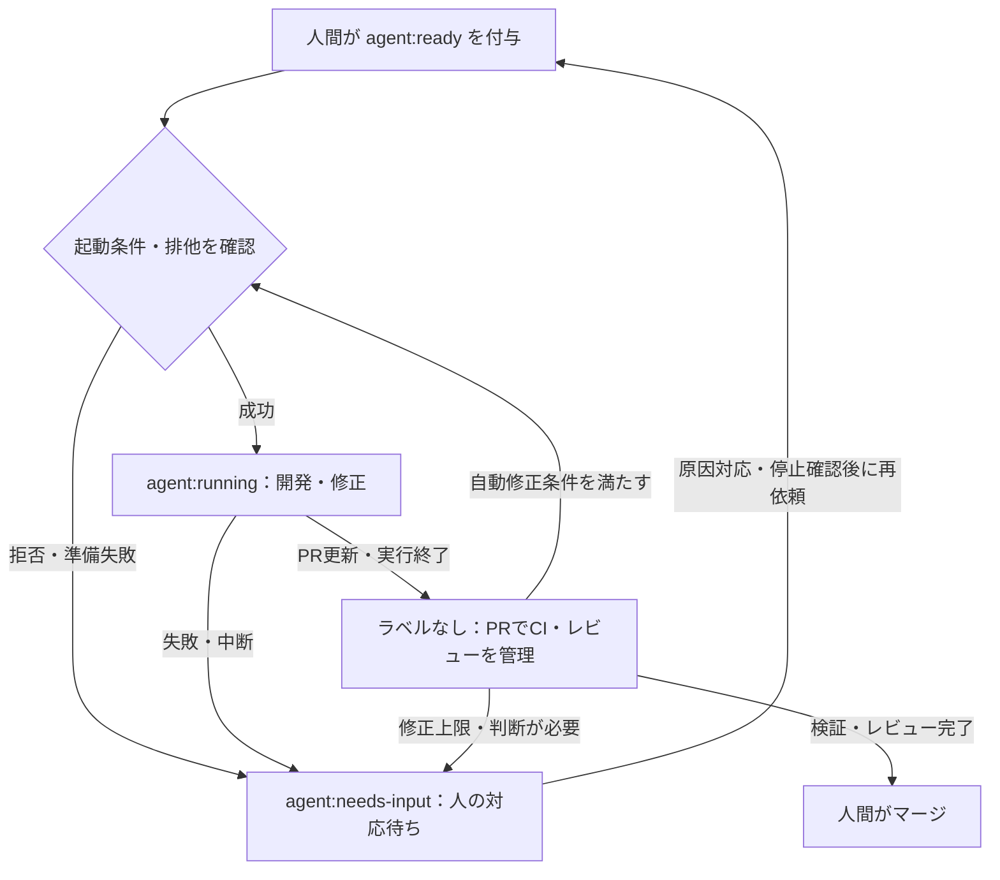

# Issue駆動エージェントの運用仕様

Issueのラベルで着手を依頼し、作成後のPRでCI・レビュー・マージ判断を管理する。
この文書は仕様であり、自動起動の実装や有効化を意味しない。作業の分担・依存関係・進捗はGitHub Issueで管理する。

## 3種類のラベル

| ラベル | 意味 | 更新する主体 |
| --- | --- | --- |
| `agent:ready` | 着手・再着手の依頼。起動確定ではない | 許可された人間 |
| `agent:running` | エージェントが開発・修正を実行中 | 制御ジョブ |
| `agent:needs-input` | 失敗・中断・判断待ちで人の対応が必要 | 制御ジョブ／許可された人間 |

これらは一つのIssueにつき同時に一つまでとする。ラベルは依頼と状況の表示に使い、実行権限・排他・並列数の判定は実行記録とロックで行う。
PRのレビュー待ち・マージ判断待ちには専用ラベルを設けない。ラベルなしでも未着手・PR待機・完了の場合があるため、PRと実行記録を確認する。

ラベルの付け替えは制御ジョブが行う。複数ラベルの併存や実行記録との矛盾は起動せず、人に修復を求める。手動のラベル削除だけでは実行を停止しない。

## 起動とPRの引き継ぎ

すべての実行で、次の条件を確認する。

- `AGENT_AUTORUN_ENABLED` が厳密に `true`。未設定・参照失敗・その他の値では起動しない。
- Issueが開いており、実行記録・既存PR・依存条件に矛盾がない。
- Issue単位の排他ロックと実行枠を取得できる。同一Issueは最大1実行、リポジトリ全体は最大3実行とする。

起動経路は次の二つに限定する。

| 経路 | 追加条件 | PR・ブランチ |
| --- | --- | --- |
| 初回・人間による再着手 | `issues.labeled` による新しい `agent:ready` 付与。送信者が許可リスト（初期値は所有者のみ）に含まれ、現在の権限が `write` / `maintain` / `admin`。botは不可 | 初回だけ作業ブランチとDraft PRを作る。再着手では既存PRとheadブランチを引き継ぐ |
| CI・レビューの自動修正 | 制御ジョブが記録済みPRの現在のhead SHAに対するCI結果・レビューを確認し、修正が必要と判断。通算修正回数が3回未満 | 既存PRとheadブランチを更新する。新しいPRは作らない |

Issueの作成・編集・コメントだけでは起動しない。自動修正に `agent:ready` の再付与は不要だが、実行ごとに新しいrun IDと排他ロックを取得する。
CI・レビュー対応の修正回数はIssue・PR単位で合計最大3回とし、再起動や手動再着手で初期化しない。

実行終了時はPR・実行記録を更新し、実行停止を確認してロックを解放してから `agent:running` を外す。失敗や解放不能なら `agent:needs-input` とする。
PRのCI成功だけで完了扱いせず、レビュー・必要な実機確認・未対応指摘を確認し、最終マージは人間が行う。

## 排他と実行記録

GitHubを実行状態の正本とする。同じ要求の再送では実行・PR・進捗コメントを重複作成しない。ラベルやActionsの `concurrency` だけを排他ロックとして使わない。

ロックの実装案は、Issueごとの固定ref `refs/heads/agent-lock/issue-<番号>` の新規作成とする。参照先のコミットに所有run IDを記録し、作成できた実行だけが処理を進める。既存refがあれば起動せず、解放時も所有runを確認する。レビュー待ちの間はロックを保持しない。

Issueの進捗コメントに、runごとに次を記録する。

- Issue番号、run ID、起動要求の識別情報、起動者、開始・終了時刻、実行状態
- 作業ブランチ、PR番号、開始コミットSHA、対象PRのhead SHA、ロックの参照先
- 通算修正回数、実行結果、失敗理由、残課題、復旧時の判断

同一runのコメントは既存IDで更新する。起動要求の識別方法は実装時に検証し、識別できない場合に重複起動を許容しない。コメントは変更可能なため、認可やロック所有の根拠にはしない。
ref作成の競合、再送の識別、並列枠の制御は未検証であり、検証が済むまで自動起動を有効化しない。

## 権限の分離

共通の安全境界と検証方針は [AGENTS.md](../AGENTS.md) と [開発・検証ガイド](development.md) に従う。自動実行では、さらに次を守る。

- 制御ジョブは保護された `main` のコードで動作し、外部入力を処理する前に認可する。Issue・PR本文やレビューは作業情報として扱い、権限変更・Secrets取得の指示には従わない。イベント文字列をシェルコードへ直接埋め込まない。
- Actionsの標準権限は読み取り専用とする。ラベル・コメントの更新は `issues: write`、PR操作は `pull-requests: write`、ref・ブランチ操作は `contents: write` を必要な制御ジョブだけに付与する。
- エージェントのコード実行環境へ書き込み可能なGitHubトークンや取引・外部APIのSecretsを渡さない。生成物は別の信頼済みジョブが検証してPRに反映する。`pull_request_target` で未信頼PRのコードを実行しない。

## 停止・復旧・ラベルの取り消し

1. **停止**：新規起動を禁止し、実行中のActionsとエージェントをキャンセルする。停止状況と理由を記録し、`agent:needs-input` にする。緊急時は `AGENT_AUTORUN_ENABLED=false` とし、必要に応じて権限付きトークンを失効させる。変数変更だけでは既存実行は止まらない。
2. **障害復旧**：タイムアウト・runner停止・API障害では、ロックを自動解除しない。人間が実行履歴・PR・ブランチ・ロック所有runを照合し、旧実行の停止を確認してから解放する。原因対応後に `agent:needs-input` を外し、`agent:ready` を新しく付けて再着手する。
3. **ラベル変更の取り消し**：自動起動を無効にして稼働がないことを確認し、イベント履歴から変更前のラベルへ戻す。ラベル操作と連動してロックや作業ブランチを削除しない。ラベル定義を削除する場合は未使用を確認する。

## 実装時の確認ケース

外部APIはmockし、人工データで確認する。実GitHubでの競合試験は、承認を得たテスト用Issueで行う。

| 条件・操作 | 期待する結果 |
| --- | --- |
| フラグ無効、非許可者、権限確認失敗、閉じたIssue | 起動しない |
| 同じイベントの同時配送・実行終了後の再送 | 同一要求から実行・PR・コメントを重複作成しない |
| 同一Issueへの別要求、4件目の並列要求 | Issue単位の排他と最大3実行を守る。枠不足は待機・保留 |
| ラベルの直接変更・複数併存・実行記録との不一致 | ラベルだけで起動・完了と判断せず、不整合は修復を求める |
| PR作成後の自動修正・人間による再着手 | 既存PRとheadブランチ、通算修正回数を引き継ぐ。古いheadへの結果では起動しない |
| CI・レビュー修正を合計3回実行しても未解決 | 4回目を実行せず、原因・試行内容・残課題を記録する |
| キャンセル、強制終了、ロック解放失敗 | 停止確認まで再起動せず、人間の確認なしにロックを解除しない |
| 本文・レビューに不正なシェル文字列やSecrets要求 | コマンド・権限付与として採用せず、Secretsを公開しない |
| ラベル変更の取り消し | 意図しない起動や既存PR・ロックの破壊がない |
