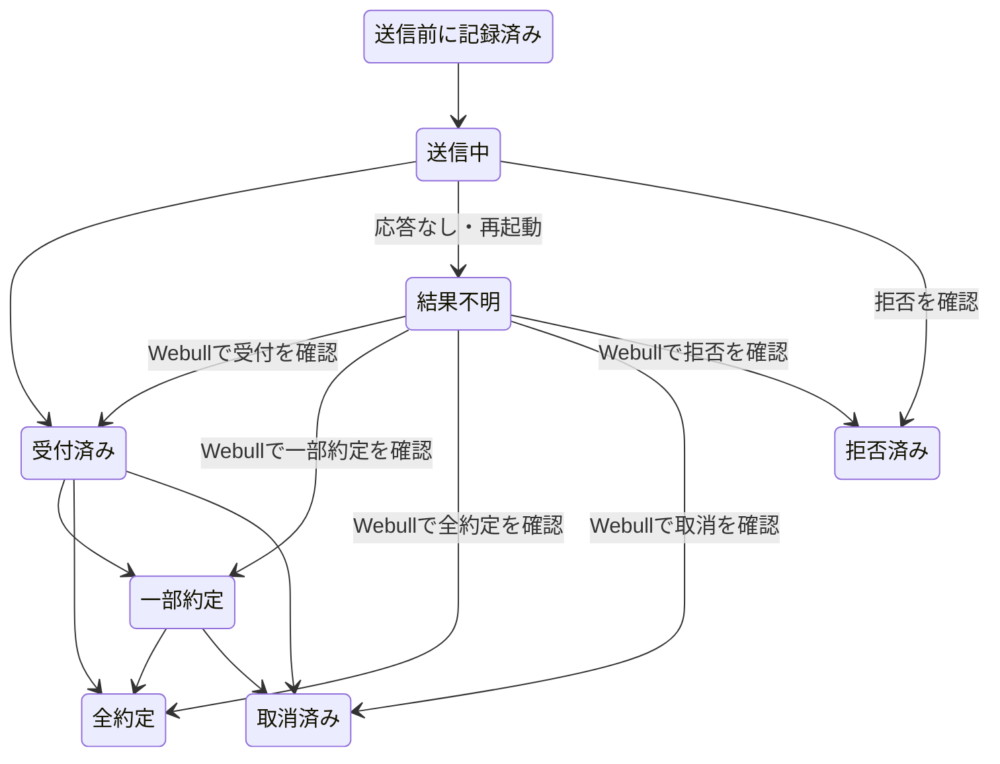

# Webull証券で米国株を自動売買するための設計

[Issue #45](https://github.com/yu1Ro5/quant-lab/issues/45) の設計資料です。本番では、相場の取得から注文・約定・保有の確認まで、Webullの情報で完結させます。ORB（寄り付き直後の値幅を基準に売買を判断する戦略）は、米国市場の通常取引時間を基準にします。

## 1. 利用条件と確認状況

2026-11-26にユーザーが日本向け本番環境で相場履歴と口座一覧の読み取りを確認しました。確認範囲と未検証事項は次節に記載します。公式案内ではOpenAPIの利用申請と、OpenAPI用の相場情報の別途申請が必要です。[利用条件と申請手順](https://www.webull.co.jp/help/faq/1727)

| 項目 | 公式資料で確認できたこと | 確認が残っていること |
| --- | --- | --- |
| 認証 | SDKがAPIリクエストに署名し、取引・口座操作にはWebullアプリで認証したトークンを使う。[認証概要](https://developer.webull.co.jp/apis/docs/about-open-api/) | トークン失効後の再認証に、人の操作が必要となる条件。 |
| 米国株の注文と口座 | 発注・訂正・取消・注文照会、口座情報・保有ポジションの取得が案内されている。[国内サービス案内](https://www.webull.co.jp/open-api) | 利用口座で照会できる取引余力の項目、送信時に付けた注文識別子での照会範囲、一部約定の復元方法。 |
| 相場 | 履歴の5分足（M5）、リアルタイム配信、無料のNasdaq Basicが案内されている。アプリ用の購読とは別にOpenAPI用の購読が必要。相場のHTTP APIは60秒に300回まで。[相場API一覧](https://developer.webull.co.jp/apis/docs/market-data-api/overview/) | 対象銘柄の配信範囲、ライブ運用で確定足を取得できる時刻、ライブと履歴の一致。 |
| 費用 | OpenAPI経由の取引に追加料金はなく、通常の取引手数料が適用される。[取引API FAQ](https://developer.webull.co.jp/apis/docs/trade-api/faq/) | 利用する口座・購読プランに適用される費用。 |
| テスト環境 | Webullはサンドボックスを提供し、公開された共有テスト認証情報を申請なしで利用できると案内している。[導入ガイド](https://developer.webull.co.jp/apis/docs/getting-started/) | 日本向けUATと本番の相場・非空の保有および注文応答の差。 |

米国株の成行・指値・逆指値など、残高・取引余力・保有の照会、注文履歴・詳細、gRPCによる注文イベント配信が公式に案内されています。本番で実測した読み取りの範囲は次節に記載します。[Trading API一覧](https://developer.webull.co.jp/apis/docs/trade-api/overview/)

OpenAPIの米国株・ETF相場は無料のNasdaq Basicなどの購読が必要で、アプリ用購読とは別です。公式資料はLV1/LV2への同時アクセスを1デバイスに制限しています。個別口座の購読種別や料金は今回確認していません。[相場API一覧](https://developer.webull.co.jp/apis/docs/market-data-api/overview/)

相場のHTTP APIは時刻をUnixミリ秒で返すと案内されています。米国株5分足の時刻が区間の始まりか終わりかは、確認できた日本向け資料では未確認です。米東部時間09:30から09:35までの最初の区間を使って確かめます。[Data API仕様](https://developer.webull.co.jp/apis/docs/market-data-api/data-api/)

## 2. 本番の読み取り確認と残る検証

2026-11-26 JST、ユーザーが提示した本番のOpenAPI相場購読画面で、米国株のレベル1プラン `Nasdaq Basic Non-Display` が無料承認済みで、期限表示が2027-11-25であることを確認しました。OpenAPIの登録一覧では、API利用権限が「マーケットデータ/取引ツール」と表示されました。個別の発注・訂正・取消の可否は未検証です。

2026-11-26 JST、ユーザーがMacのターミナルから `uvx`、Python 3.13、Webull公式Python SDKを使い、日本向け本番 `api.webull.co.jp` に接続しました。認証情報はmacOSのログインキーチェーンから取得しました。

- Market Data APIの `AAPL` / `US_STOCK` / `M5` 履歴足照会はHTTP 200で空でないJSONを返しました。
- Trading APIの口座一覧照会はHTTP 200で空でないJSONを返しました。
- 両照会でiPhoneのウィブル証券アプリによる二段階認証を行い、SDKのトークン状態は `PENDING` から `NORMAL` になりました。実行ごとに別の一時トークンディレクトリを使用したため、それぞれ認証しました。
- 追加検証では、同じ本番用トークンディレクトリを使って別のPythonプロセスから口座一覧を再照会し、iPhoneでの追加承認なしでHTTP 200が返りました。
- 2026-11-26に、この環境の `webull-uat` MCPから `AAPL` / `US_STOCK` / `M5` / `RTH` を2本照会し、空でない応答を確認しました。接続先の日本向けUATとの同一性は未確認です。

ユーザーが日本向け本番で追加の読み取りを実施し、以下の4件でHTTP 200を確認しました。

| 照会 | 結果 |
| --- | --- |
| 残高・取引余力 | `total_cash_balance` と、通貨別の `account_currency_assets[].cash_balance`、`account_currency_assets[].buying_power` が文字列型で返ることを確認。 |
| 保有 | 空の一覧。 |
| 未約定注文 | 空の一覧。 |
| 注文履歴 | 空の一覧。 |

保有・注文データが存在する場合の応答、注文IDによる照合、一部約定の復元、取引権限、本番の相場データ品質は未確認です。

別のセッションでのWebull UATとmoomoo MCPのAAPL 5分足10本の比較では、OHLCが全項目一致した足は4本で、全10本で出来高に差がありました。引けの足では出来高に大きな差がありましたが、集計条件と原因は未確認です。これは本番のWebullとmoomoo SDKデータの同等性を示すものではありません。#44のmoomoo基準入力と品質判定の方針は別途維持します。

2026-11-26 JST、ユーザーが公式Python SDKと共有テスト口座で日本向けUAT（`jp-openapi-alb.uat.webullbroker.com`）を照会しました。口座一覧・残高と取引余力・保有・未約定注文・注文履歴はすべてHTTP 200でした。口座一覧は3件、残高はJSONオブジェクト、保有と注文の3照会は空の一覧でした。SDKはこの実行でトークン認証が無効と報告しました。

発注しない確認手順は次のとおりです。

1. 口座開設後にOpenAPIを申請し、承認状況を確認する。相場取得前にOpenAPI用の購読と対象市場の権限を確認する。
2. テスト環境で認証し、注文一覧、保有、取引余力を読み取る。空の注文一覧と、権限不足や通信エラーを区別して記録する。注文の作成・訂正・取消は行わない。
3. 通常取引の寄り付き前から、同一銘柄のWebull相場を観測する。足に付いた時刻、受信時刻、OHLCVの更新を記録し、最初の5分間が09:30と09:35のどちらで示されるか、どの時点で確定値を使えるかを確認する。配信が約定単位の場合は、同じ通常取引の5分区間に集計する。
4. 引け後に同じ銘柄・日付・取引時間帯のWebull履歴足を取得する。価格調整と出来高の単位をそろえ、寄り付きレンジの高値・安値と、同じ戦略設定でのブレイク判定を照合する。差があれば、該当する足と判定への影響を記録する。

相場の観測と引け後の照合は未実施です。実施後は、日付、環境、銘柄、確認結果と残った制約をここに追記します。認証情報・個別口座情報・実取得データはGitに含めません。B2へ進む判断は、口座照会、相場の時刻と再現性、応答が途絶えた注文の照合方法を確認してから行います。

## 3. 本番運用の設計

| 担当 | 処理 |
| --- | --- |
| 相場取得 | Webullから相場を取得し、通常取引の確定足と欠損を判定する。 |
| 戦略判定 | 確定足から寄り付きレンジを求め、売買候補を作る。 |
| リスク判定 | Webullの保有・余力、未約定注文、停止状態を確認して、発注の可否を判断する。 |
| 注文管理 | 発注前の記録と、送信・受付・約定・取消などの状態を管理する。 |
| 口座照合 | Webullの注文・約定・保有をローカルの記録と突き合わせる。 |
| 監視 | 欠損、切断、照合の不一致、停止状態を運用者に知らせる。 |

本番とテストでは接続先・認証情報・注文記録を分けます。起動時に環境と口座を確認し、既存注文・保有の照合が済んでから新規発注を許可します。本番発注は本番移行の合格が明示されるまで無効とします。

**二重発注の防止。** 同じ売買判断には同じ識別子を割り当て、発注意図と送信中の状態を保存してから送信します。同じ識別子の送信開始は一度だけ許可します。応答がなければ「結果不明」とし、再起動後も再送せず、Webullの注文・約定を照合します。注文一覧に見つからない場合も停止を維持し、運用者が確認できるようにします。一部約定後に取消された場合は、約定済み数量を保有の照合に使います。

**欠損・切断。** 必要な足が欠けたり相場接続が切れたりした場合、新規エントリーを止めます。復旧後にWebull履歴で足を補っても、停止中に過ぎたブレイクを遡って発注しません。既存注文と保有の照合は継続し、照合先も切断中なら再接続時に突き合わせます。

**緊急停止と再開。** 緊急停止で新規発注を遮断し、再起動後も停止を維持します。監視と照合を続け、停止前に送信した注文の約定も反映します。未約定注文の取消と保有の決済は、それぞれ独立した操作として扱います。相場の欠損が解消し、注文・約定・保有の照合が済み、結果不明の注文が解消したうえで、運用者が停止を解除します。
